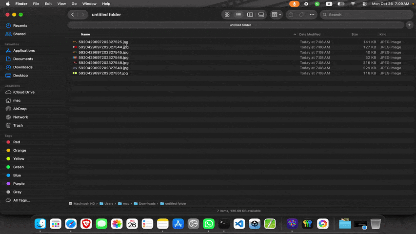

<p align="center">
  
</p>

<h1 align="center">Micasa</h1>

<p align="center">
  A fast, native photo viewer and editor for macOS on Apple Silicon.
</p>

<p align="center">
  
  
  
  <a href="LICENSE"></a>
</p>

Open a photo from Finder and it fills the screen over a dimmed desktop, or floats on the desktop as a borderless window that is just the photo. Edit it, save a copy, move on.

<p align="center">
  
</p>

## What works

- **Viewing** — fullscreen over a dimmed desktop, or borderless floating windows (several at once). Double-click to switch.
- **Formats** — JPEG, PNG, HEIC/HEIF, AVIF, JPEG XL, JPEG 2000, WebP, TIFF, GIF, BMP, PSD, OpenEXR and camera RAW.
- **Animation** — animated GIF, APNG, WebP and HEICS, with adjustable speed.
- **Motion Photos** — Pixel/Android, Samsung and Apple Live Photos: play inline or save the clip.
- **Editing** — exposure, contrast, highlights, shadows, saturation, vibrance, warmth, tint, sharpen, soften, vignette; crop with aspect presets, rotate, mirror; five one-click looks; undo/redo and hold-to-compare.
- **Saving** — original format, PNG, JPEG, HEIC or WebP, with scale and quality. Saves a copy and keeps camera metadata; the original is never overwritten.
- **Navigation** — ←/→ through the folder, scroll and pinch to zoom, trackpad swipe, drag and drop, Move to Trash.

## Built with

Swift and Apple frameworks only — no third-party libraries.

| | |
|---|---|
| SwiftUI | All in-window interface: toolbars, editor, crop, settings |
| AppKit | App lifecycle, menus, borderless fullscreen and floating windows, mouse and trackpad input |
| ImageIO | Decoding every format, EXIF, animation frames, encoding on save |
| Core Image + Metal | GPU edit pipeline |
| AVFoundation / AVKit | Motion Photo and Live Photo playback |
| Observation | App and editor state |

## Install

Requires macOS 14 or later and Xcode or the Command Line Tools (`xcode-select --install`).

```bash
git clone https://github.com/ImRiz1/micasa.git
cd micasa
./build-app.sh --install
```

This builds `Micasa.app` and copies it to `/Applications`. Then right-click any photo in Finder → **Open With → Micasa**, or set it as the default viewer in **Settings (⌘,)**.

Other options: `./build-app.sh` (build only, into `build/`), `./build-app.sh --universal` (Apple Silicon + Intel).

## Shortcuts

| Key | Action |
|---|---|
| ← → | Previous / next photo |
| + − / scroll / pinch | Zoom |
| F · 1 | Fit · actual pixels |
| Space | Play motion or animation |
| E · C | Edit · crop |
| ⌘Z · ⇧⌘Z | Undo · redo |
| ⌘S · ⇧⌘S | Save copy · save as |
| I | Photo info |
| ⌃⌘F | Fullscreen / floating |
| Esc | Back out: crop → editor → fullscreen → close |

## License

[BSD 2-Clause](LICENSE).
